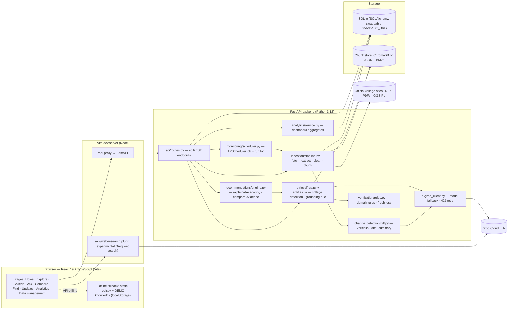
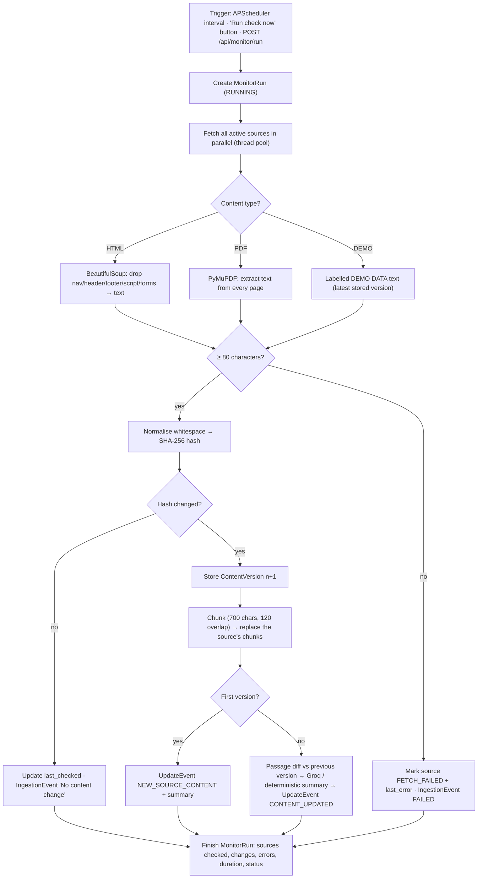
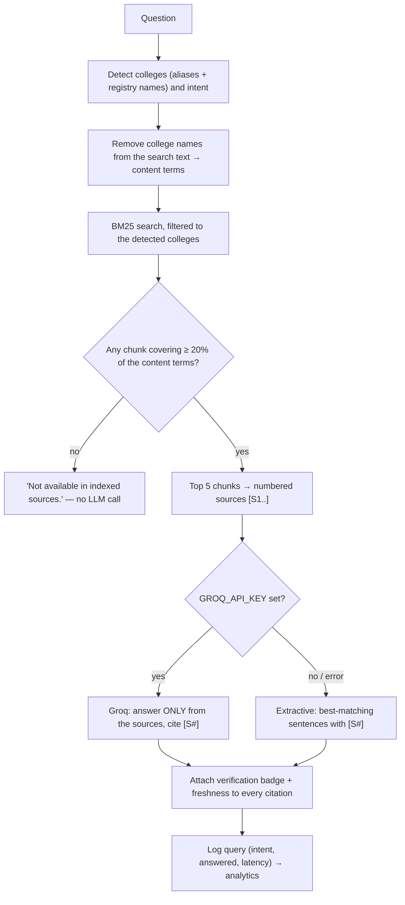
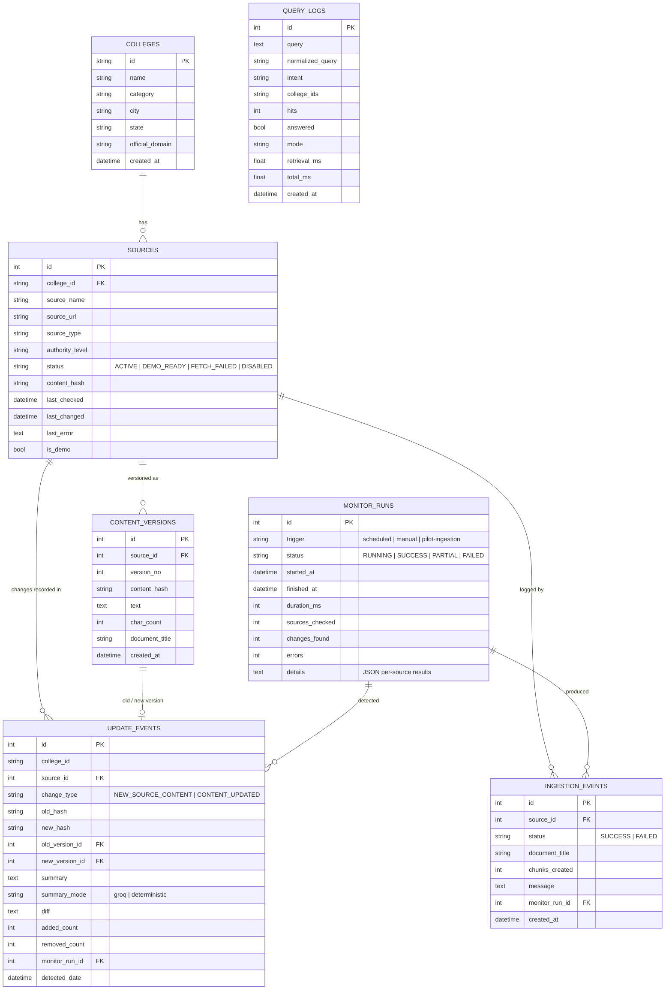
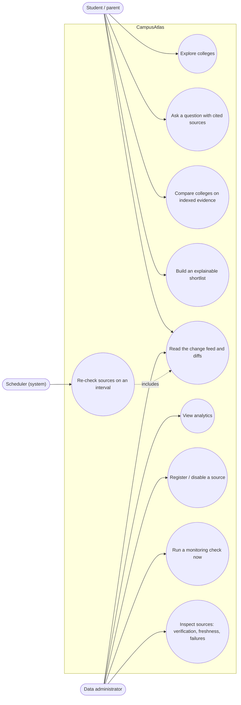

# CampusAtlas — Architecture

CampusAtlas is a source-grounded college intelligence platform. It registers official sources for each college, ingests and versions their content, and monitors them for changes. It answers questions only from what it has indexed, and it cites every source with a verification badge and a freshness indicator.

## 1. System architecture



## 2. Modules

| Module | File(s) | Responsibility |
|---|---|---|
| Configuration | `app/config.py` | Merges root and backend `.env` files, anchors relative paths, and holds the monitoring, freshness and retrieval settings |
| Database | `app/database.py`, `app/models/models.py` | SQLAlchemy engine, 7 tables, and a forward-only column migration for databases created before Phase 5 |
| Seeding | `app/seed.py`, `app/pilot_sources.py` | Idempotent registry (53 colleges), 4 DEMO sources and 42 pilot sources |
| Ingestion | `app/ingestion/pipeline.py` | HTTP fetch (OS trust store), HTML boilerplate removal, PyMuPDF PDF extraction, word-boundary chunking with overlap, SHA-256 hashing, failure marking |
| Change intelligence | `app/change_detection/diff.py` | Passage-level diff (difflib), plus a Groq summary or a deterministic diff summary |
| Monitoring | `app/monitoring/scheduler.py` | APScheduler interval job, parallel fetch (thread pool), sequential DB processing, one run at a time (lock), `MonitorRun` log |
| Verification | `app/verification/rules.py` | Official / Third-party / Unverified by domain rules; freshness (fresh, stale, never checked) |
| Chunk store | `app/services/vector_store.py` | ChromaDB when installed, otherwise JSON + BM25; replaces a source's chunks as one set |
| Retrieval and QA | `app/retrieval/entities.py`, `app/retrieval/rag.py` | College alias detection, intent classification, relevance threshold, the grounding rule, Groq context-only answers, extractive fallback |
| Decision support | `app/recommendations/engine.py` | Explainable preference scoring; evidence table for comparisons |
| Analytics | `app/analytics/service.py` | Totals, timelines, breakdowns, top queries, latency |
| LLM client | `app/ai/groq_client.py` | Groq chat completions, retired-model fallback, 429 retry, reasoning-tag cleanup |
| Frontend | `frontend/src.tsx`, `frontend/src/pages/*`, `frontend/src/services/api.ts` | Routes, Phase 5 pages, badges, API client with offline fallback |

## 3. Data flow

### 3.1 Ingestion and change detection



### 3.2 Question answering (grounding rule)



## 4. Database schema (ER)



Chunks live in the chunk store, not in SQLite. Each chunk carries this metadata: `college_id, source_id, source_url, source_name, source_type, authority_level, document_title, doc_type, version_no, chunk_index, is_demo, ingested_at`.

## 5. Use cases



## 6. Sequence: an AI query

```mermaid
sequenceDiagram
    actor U as Student
    participant FE as React (Ask page)
    participant VP as Vite proxy
    participant API as FastAPI /api/ask
    participant RAG as rag.answer()
    participant VS as Chunk store (BM25)
    participant DB as SQLite
    participant G as Groq

    U->>FE: "Does MAIT offer ECE?"
    FE->>VP: POST /api/ask {query}
    VP->>API: forward
    API->>DB: load registry (ids, names)
    API->>RAG: answer(query, registry)
    RAG->>RAG: detect colleges → [mait]; intent → academics
    RAG->>VS: query("offer ece", college_ids=[mait])
    VS-->>RAG: ranked chunks + coverage
    alt no chunk above threshold
        RAG-->>API: "Not available in indexed sources." (LLM not called)
    else evidence found
        RAG->>G: system: answer ONLY from SOURCES; user: question + [S1..S5]
        G-->>RAG: "Yes … intake of 120 [S1]"
        RAG->>DB: source rows → verification + freshness per citation
        RAG-->>API: answer, sources, mode, latency
    end
    API->>DB: insert QueryLog (intent, answered, latency)
    API-->>FE: JSON
    FE-->>U: answer + citation cards (Official · Checked 2 h ago · DEMO DATA if any)
```

## 7. Sequence: scheduled monitoring run

```mermaid
sequenceDiagram
    participant S as APScheduler / "Run check now"
    participant M as run_monitoring_cycle
    participant W as College websites
    participant P as pipeline.process_text
    participant DB as SQLite
    participant VS as Chunk store
    S->>M: trigger
    M->>DB: MonitorRun(status=RUNNING)
    par fetch in parallel
        M->>W: GET source 1..n
        W-->>M: HTML / PDF
    end
    loop each source
        M->>P: extracted text
        P->>DB: compare hash; store ContentVersion if changed
        P->>VS: replace the source's chunks
        P->>DB: UpdateEvent (diff + summary) / IngestionEvent
    end
    M->>DB: MonitorRun(SUCCESS | PARTIAL, counts, duration)
```

## 8. Design decisions

- **The grounding rule is enforced in code, not only in the prompt.** If retrieval returns nothing relevant, the LLM is never called (test T22).
- **Verification is deterministic.** Domain rules are explainable and testable; an LLM does not judge authority.
- **The extractive fallback** keeps the app usable and honest without a key, during rate limits and offline.
- **Chunks are replaced per source,** so a page that removes old information can no longer be cited.
- **Fetching is parallel; DB writes are sequential.** A 46-source check takes ~7 s with no SQLite write contention.
- **Failure is data.** Unfetchable sources stay registered and are marked `FETCH_FAILED` with the reason, and answers say "Not available in indexed sources."
